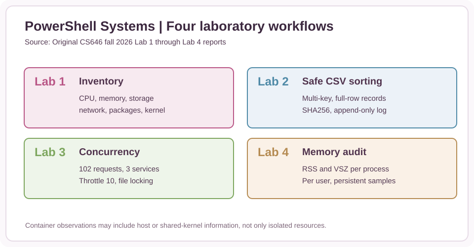
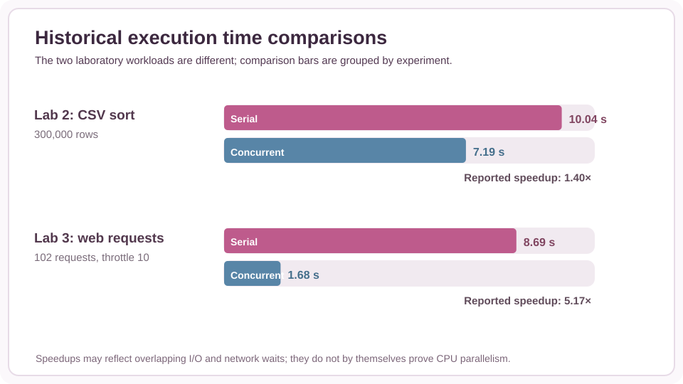
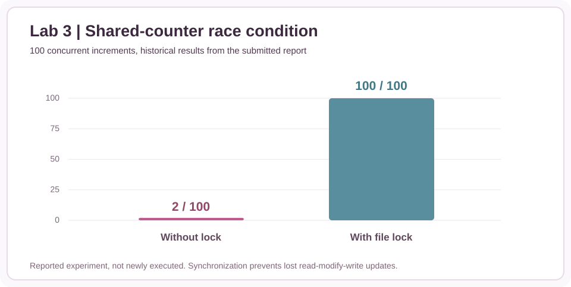
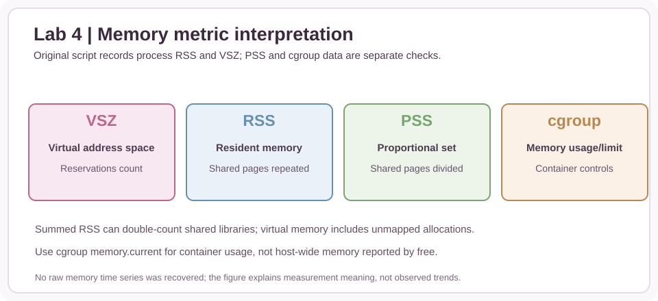

# PowerShell Systems & Concurrency | Engineering Recovery

**Project 16 / 16 | CS646 Operating Systems | Fall 2026**

Four original student laboratory reports are available in the owner's private archive. Their documented achievements cover Linux container inventory, safe multi-key CSV sorting, bounded concurrency, and periodic memory auditing. This public portfolio directory preserves **one genuinely recovered original PowerShell source script**, plus new analytical tools and diagrams. It does **not** publish the complete coursework reports, source screenshots, personal system output, or missing original scripts.

## Recovered and reconstructed project visuals

Every numerical plot is explicitly sourced to the earlier course report or calculated from its published summary values. No raw data traces were inferred.

## Files and provenance

| File | Status | Purpose |
|---|---|---|
| [memory-audit.ps1](original/memory-audit.ps1) | **Recovered original** | Periodic process and user RSS/VSZ accounting with append-only CSV and threshold flag |
| [safe-sort-reconstruction.ps1](reconstructed/safe-sort-reconstruction.ps1) | **New reference code** | String-based stable CSV sorting with before/after input SHA256, distinct output and append-only log |
| [bounded-concurrency-demo.ps1](reconstructed/bounded-concurrency-demo.ps1) | **New reference code** | Synthetic local parallel tasks and synchronized JSON-line output; no external web requests |
| [lab_results_audit.cjs](analysis/lab_results_audit.cjs) | **New independent calculations** | Source-reported timing speedups, provenance and reference row sorting |
| [lab_results_audit.test.cjs](analysis/lab_results_audit.test.cjs) | **New tests** | Ten offline numerical/record-integrity cases |
| [reported_metrics.csv](data/reported_metrics.csv) | **Historical transcription** | Reported point estimates and experiment context, not raw observations |
| [Evidence matrix](docs/EVIDENCE_MATRIX.md) | **New documentation** | Lab-by-lab reported outcomes and recovered artifact status |
| [Safety and concurrency notes](docs/SYSTEMS_AND_CONCURRENCY.md) | **New documentation** | Critical sections, log integrity, speedup interpretation and container boundaries |
| [Memory accounting](docs/MEMORY_ACCOUNTING.md) | **New documentation** | RSS vs PSS vs virtual/VSZ and cgroup scope |
| [Verification and limitations](docs/VERIFICATION.md) | **New documentation** | Clearly distinguishes reports, tests and rerun requirements |

## Historical outcomes, as reported

| Report | Setup | Duration or result |
|---|---|---|
| Lab 1, inventory | Debian Linux container | 16 logical CPUs visible, 15 GiB reported by free; visibility does not imply exclusive allocation |
| Lab 2, sorting | 300,000 CSV records | 10.04 s standard vs 7.19 s parallel; **1.40× historical speedup** |
| Lab 3, concurrency | 102 requests across three hosts, throttle 10 | 8.69 s serial vs 1.68 s concurrent; **5.17× historical speedup** |
| Lab 3, race | 100 concurrent increments | Unsafe count 2 vs synchronized count 100 |
| Lab 4, memory | Periodic process snapshots | Original script recovered; no original raw time-series CSV is published |

The Lab 3 conclusion mistakenly says **10 requests** even though its design, testing section and repeated evidence state **102**. We use the supported 102-request value, record the inconsistency, and do not manufacture a missing task log.

## How to inspect or use

With PowerShell 7+ and the required Linux commands installed:

~~~powershell
pwsh -NoProfile -File projects/powershell/original/memory-audit.ps1 -Samples 3 -IntervalSeconds 2 -CsvPath ./memory-test.csv
pwsh -NoProfile -File projects/powershell/reconstructed/safe-sort-reconstruction.ps1 -InputCsv ./input.csv -OutputCsv ./sorted.csv -Primary Department -Secondary Name
pwsh -NoProfile -File projects/powershell/reconstructed/bounded-concurrency-demo.ps1 -OutputLog ./synthetic-tasks.jsonl
~~~

**Execution status:** PowerShell itself was not available in the engineering-recovery runtime, so the newly reconstructed `.ps1` scripts were not executed here. They require testing in an actual PowerShell 7/Linux environment. They are not verbatim copies of the original Labs 2 and 3 submissions. The original Lab 4 script was recovered from the user's file archive and still must be verified in its target environment.

Independent calculations and unit tests require Node.js only:

~~~bash
node projects/powershell/analysis/lab_results_audit.cjs
node --test projects/powershell/analysis/lab_results_audit.test.cjs
~~~

Ten tests passed in a JavaScript assertion harness during this reconstruction. Those tests validate arithmetic and synthetic row-sorting examples, **not historical benchmark reproducibility or the PowerShell scripts**.

## What remains missing

Original complete source scripts for Labs 1–3, the Lab 4 output CSV, the raw 102-request log, 300,000-row input, original exact benchmark environment and any traceable measurements needed to rerun. Original lab report PDFs are intentionally kept out of this public repository.

Back to [PowerShell Systems & Concurrency portfolio page](../powershell.html).
