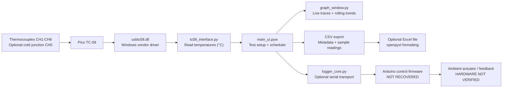

# Thermal Controller & Logger | Recovered architecture

**Evidence level:** reconstructed from public source inspection on 2026-10-11; no hardware execution has been performed.

## Functional system block diagram

## What is present in the source

1. **Measurement:** `tc08_interface.py` loads `usbtc08.dll`, opens a TC-08, configures channels 0–8 as K-type by default, obtains single reads and returns temperature values in degrees Celsius.
2. **Scheduling:** `main_ui.pyw` requests the next poll using Tkinter `after(SAMPLE_INTERVAL*1000)`. `logger_core.py` sets `SAMPLE_INTERVAL = 1.0` second. The application is not a deterministic real-time logger; actual sample times should be independently measured.
3. **Channel configuration:** 0–8 selected user inputs; channel 0 may be logged as CJ; channels 1–8 are probe inputs.
4. **Metadata:** Test name, tester, fixture and notes are placed in the CSV preamble. The run may have a configured duration or be stopped by the user.
5. **Visual trend rule:** `main_ui.pyw` tracks the last 10 valid readings by default and calls a channel stable when `max(window)-min(window) <= 3.0 °C`. The values and window length can be adjusted in the interface.
6. **Graphing:** `graph_window.py` retains at most `MAX_GRAPH_POINTS = 2000` plotted data points per channel in memory and supports pan, zoom, channel selection and hover readout. CSV logging continues independently.
7. **Output:** CSV contains a metadata row, one blank row, the `Data_Sample` header and numeric sample values serialized as strings. The optional `openpyxl` converter copies rows into a styled workbook.
8. **Ambient control:** `logger_core.py` opens an Arduino COM port, default **9600 baud**. Commands include `SET:<temperature_C>` and `AMB:<temperature_C>`. Typical reply: `AMB:38.42,HOLD:40.00,PWM:155,STATUS:OK`. The program can schedule stepped setpoints with a hold time.

## Evidence and concerns

- **Source confirmed:** Python modules, GUI control, temperature acquisition code, serial protocol, CSV and Excel export code.
- **Not confirmed:** Accuracy, thermocouple calibration, driver version compatibility, acquisition rate, heat-actuator safety, controller gain/tuning, full physical system behavior.
- **Original Arduino firmware missing:** Only its expected serial protocol is recovered. No controller circuit or wiring diagram is established.
- **No per-sample real timestamps in CSV:** `Data_Sample` is an integer count. A nominal one-second timer does not constitute exact timing evidence.
- **DLL loading on import:** `tc08_interface.py` references `ctypes.WinDLL` before application setup. It cannot be used as an offline simulator without modification.
- **Verify ABI:** `tc08_interface.py` loads the DLL using `WinDLL` at module scope and `CDLL` in the class; this mixed calling-convention approach warrants comparison to Pico's official driver interface, especially before deploying to different Python bitness.
- **Hard-coded output folder:** The GUI uses a mapped `Z:` drive path if available, otherwise `logs/` in the working directory. Confirm folder access and permissions before a test.

## Thermal calculations, distinguished from instrument calibration

For a valid recorded channel series (T_1, T_2, \dots, T_N):

- Mean: `mean(T) = sum(T_i) / N`
- Observed range: `max(T_i) - min(T_i)`
- Sample standard deviation: `sqrt(sum((T_i - mean)^2)/(N-1))` for (N>1)
- Last-window change: `T_last - T_first`
- Original GUI descriptive stability rule: `last_window_range <= configured_band`

The provided `analysis/thermal_csv_audit.py` implements these offline calculations over *existing* exported logs, only for channels whose headers end with `_C`. Because original log values have no timestamps, it does not estimate thermal time constants, heating rates, or sampling precision.

**Interpretation:** These computations are descriptive statistics only. They do not establish instrument calibration, measurement uncertainty, or a valid thermal equilibrium condition by themselves.
