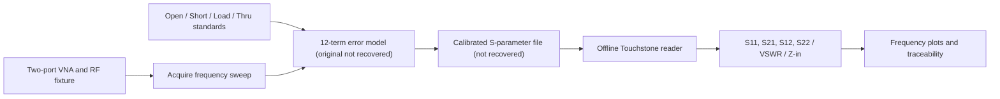

# Reconstructed RF analysis methodology

**Basis:** The published portfolio states a 2025 MATLAB workflow for two-port S-parameter testing, 12-term SOLT calibration, and a nominal 100 MHz to 6 GHz measurement range. No original source/measurement records were found in this recovery pass. The calculations here are standard RF theory, newly implemented for offline data.

## Conceptual signal chain



The reconstruction **only implements F through H**. The diagram describes the reported end-to-end methodology, not a claim that a complete calibrated VNA has been built or retested.

## S-parameters

For a linear two-port, incident waves `a1,a2` and reflected waves `b1,b2` are related by:

```text
[b1]   [S11 S12] [a1]
[b2] = [S21 S22] [a2]
```

- `S11`: input reflection with port 2 matched
- `S21`: forward transmission, port 1 to port 2
- `S12`: reverse transmission, port 2 to port 1
- `S22`: output reflection with port 1 matched

The standard **Touchstone 1.0 two-port data ordering** is `frequency S11 S21 S12 S22`, with each S-parameter occupying two numeric values. The supported option line is `# GHz S DB R 50` or another supported frequency unit and `RI/MA/DB` representation. Touchstone 2.0 matrices, mixed-mode data, noise sections and arbitrary reference impedance lists are **not supported**.

## Reconstructed calculations

For complex reflection coefficient `Gamma = S11` and real positive reference impedance `Z0`:

```text
S11_dB = 20 log10(|S11|)
S21_dB = 20 log10(|S21|)
ReturnLoss_dB = -20 log10(|S11|)
VSWR = (1 + |S11|) / (1 - |S11|)     when |S11| < 1
Zin = Z0 * (1 + S11) / (1 - S11)
```

At `|S11| >= 1`, the offline JSON sets VSWR to `null` rather than reporting a misleading finite VSWR. At `S11 = 1`, impedance is singular. For zero coefficient, `log10(0)` is undefined in finite JSON; the JSON analyzer reports a `null` dB field. Neither result indicates bad data by itself.

For Touchstone DB form, `S = 10^(magnitude_dB/20) * exp(j*phase_deg*pi/180)`. MA uses linear magnitude; RI uses real and imaginary components.

## Practical interpretation

- A `-20 dB` S11 corresponds to `|Gamma|=0.1` and VSWR approximately `1.222`.
- A `-3 dB` S21 corresponds to linear wave-magnitude approximately `0.708`.
- Small `S11` is generally favorable for a matched passive port, but actual DUT requirements determine acceptance.
- Passive, reciprocal assumptions are *not made* by the parser. An active device can have power gain.
- For best traceability, preserve calibration date, standard kit definitions, port mapping, frequency grid, reference impedance, DUT identification and untouched `.s2p` exports.

## Software limitations

The reconstructed MATLAB routine draws a *reflection-coefficient plane with a unit circle*, not a calibrated Smith chart. These utilities do not guarantee numerical uncertainty or correctness of source calibration; they process whatever S2P input is provided. Additional VNA vendor-specific or Touchstone 2.0 support requires a separate implementation.
